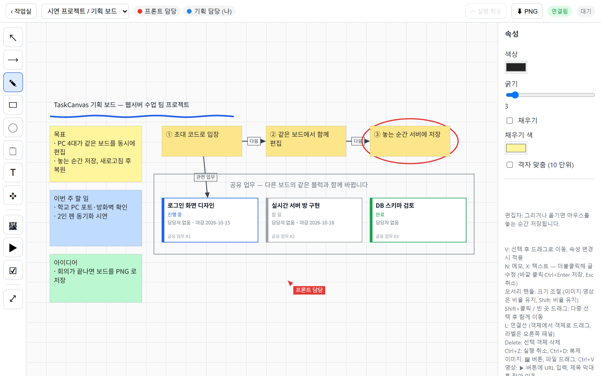

# TaskCanvas

**실시간 협업 화이트보드 기반 프로젝트 관리 웹 애플리케이션**

TaskCanvas는 여러 사용자가 같은 보드에서 그림과 자료를 편집하고, 보드 간에 공유되는 업무를 함께 관리하는 웹서버 수업 팀 프로젝트입니다. 학교 LAN 환경에서 서버 PC 1대와 접속 PC 3대로 시연하는 구성을 목표로 합니다.

---
## 1. 주요 기능

- **작업실·참여자 관리:** 회원가입 없이 작업실 직접 생성 또는 이름·초대 코드로 참여, 관리자·편집자·열람자 권한 구분, 보드 생성·이름 변경·삭제
- **화이트보드 편집:** 펜, 도형, 메모·텍스트, 이미지(PNG·JPG·WEBP, 파일당 최대 10MB), YouTube·Vimeo 영상 임베드, 객체 이동·크기 조절·연결선·다중 선택
- **실시간 협업:** Socket.IO를 이용한 펜·커서·선택 상태 공유, 참여자 따라가기, 객체 선점 잠금 및 버전 충돌 처리
- **공유 업무 관리:** 여러 보드에 같은 업무 블럭 배치, 작업실 업무 현황판, 업무 상태·담당자·마감일·체크리스트 동기화, 업무 삭제
- **분석 대시보드:** KPI 4개, 상태·담당자·일별 생성 차트, 생성일·상태·담당자 필터와 20건 업무 표
- **파일 미리보기:** CSV·JSON 업로드, UTF-8/CP949 CSV, JSON 배열 경로 선택, 전체 행 수·첫20행 표시와 세션 초안 보호
- **편집 편의 기능:** 실행 취소·다시 실행, 객체 복제, 격자 맞춤, PNG 내보내기
- **저장·복원:** 확정된 변경 사항을 데이터베이스에 저장하고 새로고침·재접속 시 마지막 저장 상태 복원
- **관리 기능:** 초대 코드 발급·취소, 작업실 삭제, 접속 점검, 시연 데이터 초기화 스크립트

---
## 2. 실행 방법 (Windows·XAMPP)

**실행 환경:** PHP 8.x, MySQL/MariaDB(XAMPP), Node.js 18 이상, npm, Chrome 또는 Edge

1. 저장소를 내려받고 프로젝트 루트 폴더에서 명령 프롬프트를 엽니다.
2. XAMPP의 MariaDB를 준비하고, **최초 설치 시** `C:\xampp\mysql\bin\mysql.exe -u root < database\schema.sql` 로 DB 스키마를 적용합니다. (기본 XAMPP 경로 기준)
3. `scripts\start-dev.bat` 을 실행합니다. 스크립트가 필요한 `.env` 파일을 예시에서 복사하고, Node.js 패키지 설치 및 서버 실행을 진행합니다.
4. 서버 PC에서 `http://localhost:8080` 으로 접속합니다. 다른 PC에서는 `http://서버IP:8080` 을 사용합니다.
5. 소개 화면에서 **새 작업실 만들기** 또는 **초대 코드로 입장**을 선택합니다.

기본 포트는 **웹/PHP 8080**, **Socket.IO 3001**, **DB 3306**입니다. PC 간 접속 시 8080·3001 포트와 방화벽 설정을 확인합니다. 환경 설정을 바꿔야 한다면 `apps/php-api/.env` 와 `apps/realtime/.env` 를 수정합니다.

학교 PC 설치, Apache 방식 배포, 초대 코드 생성, 오류 해결은 [배포·시연 가이드](docs/15-deployment-school-pc.md)를 참고합니다.

---
## 3. 테스트 및 시연

- **서버 PC 환경 점검:** `scripts\check-env.bat`
- **접속 PC 연결 점검:** `http://서버IP:8080/check.html`
- **수용 테스트:** `apps/realtime` 폴더에서 `npm run test:acceptance`
- **브라우저 자동 리허설:** 같은 폴더에서 `npm run rehearsal`
- **시연 순서:** [시연 대본](docs/16-demo-script.md)

자동 테스트·리허설은 테스트용 데이터를 생성할 수 있습니다. 초기화 스크립트(`scripts\reset-demo.bat`)는 **기존 프로젝트와 업로드 이미지를 삭제**할 수 있으므로 실행 전 [배포 가이드](docs/15-deployment-school-pc.md)의 주의사항을 확인해야 합니다.

---
## 4. 프로젝트 구조

| 경로 | 설명 |
|---|---|
| `apps/frontend/` | HTML·CSS·JavaScript 기반 화면 및 화이트보드 |
| `apps/php-api/` | 게스트·작업실·보드·파일 업로드 등 PHP API |
| `apps/realtime/` | Node.js·Socket.IO 실시간 서버 및 테스트 |
| `database/schema.sql` | 데이터베이스 초기 스키마 |
| `scripts/` | 실행·환경 점검·시연 초기화 배치 파일 |
| `docs/` | 요구사항·설계·테스트·배포·시연 문서 |
| `assets/screenshots/` | 실제 애플리케이션 화면 캡처 |
| `presentation/` | 발표 자료 |

상세 문서와 개별 모듈 사용법은 [문서 목차](docs/README.md) 및 각 `apps/` 하위 README를 참고합니다.

**2026-10-21 구현 업데이트:** 1~34일차 구현 기록을 유지하고, 기존 33~78일차 계획은 [30~40일차 압축 로드맵](docs/30-roadmap-reordered.md)을 기준으로 진행합니다. 34일차에는 회원별 저장 뷰·역할 관리·통합 검색·개인 홈·키보드 기본 흐름을 구현했습니다. 다음 35일차는 템플릿·전체 활동 기록·협업 알림입니다. 브라우저 오피스 직접 편집, Google Drive OAuth, 조건 자동화, 반복 업무, 업무 의존 관계, AI 요약은 필수 수업 범위 완료 이후의 후속 백로그입니다.

---
## 5. 현재 범위와 제한 사항

- **26일차 회원 인증:** 입장하기 오른쪽 로그인 버튼에서 회원가입·로그인 화면으로 이동합니다. 회원 생성·비밀번호 해시·로그인 유지·로그아웃과 요청 보호를 구현했습니다. [인증 설명](docs/26-member-auth.md). 27일차에 회원 작업실 초대·전환·비밀번호 재확인 게스트 연결·실시간 세션 보호를 추가했습니다. [27일차 상세](docs/27-member-access.md). 기존 비회원 게스트 입장도 유지합니다.
- **28일차 통계 API:** 작업실별 업무·담당자·마감·체크리스트 SQL 집계와 생성일·상태·담당자 필터를 구현했습니다. [API 계약·검증](docs/28-task-analytics.md).
- **29일차 분석 화면:** 작업실의 ‘분석 대시보드’에서 KPI·차트·업무 표를 같은 조건으로 조회합니다. 기본 최근 30일·최대 366일, 수동 새로고침과 모바일 배치를 지원합니다. [사용 방법·검증](docs/29-analytics-dashboard.md).
- **30일차 파일 미리보기:** 작업실의 ‘데이터 관리’에서 최대5MiB·10,000행·50열의 CSV·JSON을 업로드해 원본 첫20행을 확인합니다. 초안은15분 유효하며 확정 저장은31일차 범위입니다. [사용 방법·API·검증](docs/30-file-preview.md).
- **33일차 분석 완성:** 상태 변경을 멱등 이력으로 저장하고 기록된 변경만 추이로 표시합니다. 차트 선택으로 상세 업무를 다시 조회하며 같은 조건의 전체 CSV와 원본 보드 이동을 제공합니다. [사용 방법·API·검증](docs/33-analytics-completion.md).
- **34일차 회원 작업 흐름:** 개인 기본 조회·내 업무·최근/즐겨찾기 보드·Ctrl+K 검색·회원 역할 관리를 추가했습니다. 같은 회원 별칭 묶음과 마지막 관리자 보호, 계정 변경 시 이전 자료 폐기를 적용했습니다. [사용 방법·API·검증](docs/34-member-workflow.md).
- [수용 테스트 기록](docs/11-acceptance-tests.md)에는 개발 PC에서의 자동·브라우저 테스트 결과가 정리되어 있습니다. **학교 PC 4대의 실제 LAN 통합 테스트(AC15)는 별도 현장 확인이 필요합니다.**
- 회원은 연결한 여러 작업실을 전환하고 초대로 새 작업실에 추가 가입할 수 있습니다. 비회원의 전환은 동일 게스트가 이미 참여 중인 작업실 범위입니다. ([작업실 전환 범위](docs/23-workspace-selection.md))
- 고급 표 편집, 댓글, 흐름도 자동 배치 등은 현재 구현 범위에 포함되지 않습니다.
- 재접속 시에는 **마지막으로 확정 저장된 상태**를 복원하며, 미저장 작업은 복구되지 않습니다.
- 실제 비밀번호, 토큰, 초대 코드, `.env` 파일 및 사용자 업로드 데이터는 Git에 커밋하지 않습니다.
